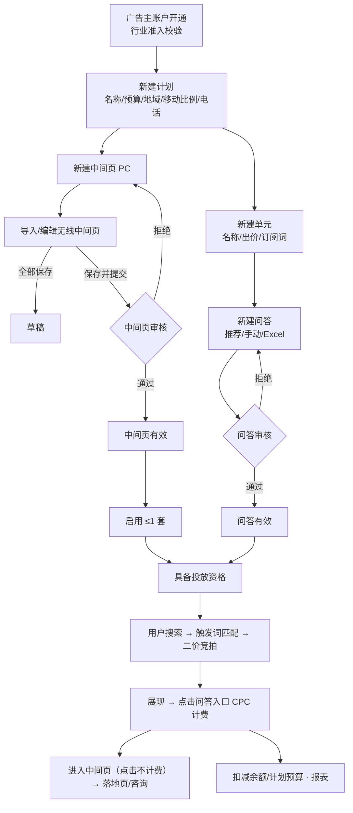
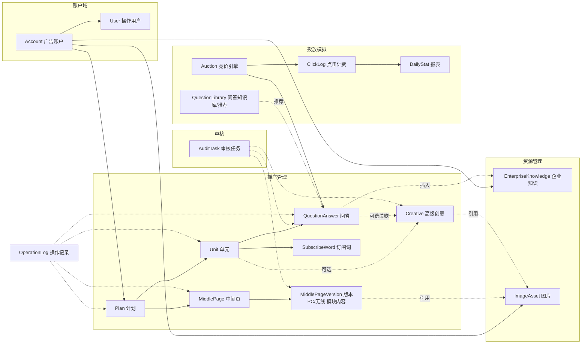

# Phoebe 重建 · 第一阶段：业务分析

> **声明**：本文档是基于公开资料与已知项目线索的**业务重建分析**，不是原 Phoebe 项目的原始设计。文中所有实体、字段、规则都按证据等级标注，未来获得合法资料后应逐项校准。

## 0. 证据等级定义

| 等级 | 标记 | 含义 |
|---|---|---|
| 已确认 | **[C]** | 已知的项目事实（Phoebe 本身的线索） |
| 公开资料支持 | **[P]** | 百度公开的知识营销产品资料明确写出（证明“产品”有此规则，**不证明** Phoebe 代码如此实现） |
| 合理推测 | **[I]** | 由 [C]/[P] 推导，或行业惯例 |
| 完全未知 | **[U]** | 无任何依据，重建时自行设计 |

关键前提 **[I]**：Phoebe 所含模块（计划/单元/问答/创意/中间页 + 百度知道、宝宝知道渠道）与公开的“知识营销 CPC 业务端”高度吻合，因此**推测 Phoebe 是知识营销 CPC 业务端（或其后端/后续版本）**。这一推测本身是全部建模的基础，若不成立，大部分 [P] 规则需重新评估。

---

## 1. 参考资料阅读结果

| 编号 | 资料 | 获取情况 | 价值 |
|---|---|---|---|
| A | 知识营销 CPC 业务端使用说明（2018-10） | ✅ 浏览器读取正文（配图未读，附带 PDF 未下载） | ★★★ 最核心：层级、流程、字段、字数限制、中间页状态规则、Excel 上传 |
| B | 知识营销 CPC 产品 FAQ（2021-05） | ✅ 浏览器读取（直接抓取返回 403） | ★★★ 数量上限、匹配方式、订阅词、展现位次、报表字段、审核时效 |
| C/D | 知识营销产品介绍（2017-09，2019-07 更新） | ✅ 两个 URL 正文相同 | ★★ 渠道/样式、中间页模块、计费 |
| E | 产品干货（2019-12） | ✅ | ★★ 问答知识库、智能推荐、PC→无线中间页导入、默认字段 |
| F | mip2-extensions-platform / baobao.baidu.com | ⏭ 未深入 | ☆ 仅宝宝知道前端生态背景，与 Phoebe API 无关 |
| G | 品牌广告投放平台操作培训（2022-04 PDF） | ✅ 提取文字（图片未读） | ★ 品牌广告平台（品专/华表/丝路），**不是知识营销**；用于划界 |
| H | 百度商业开发者中心 | ⏭ 未深入 | ☆ 搜索推广 API 通用概念 |

### 1.1 从资料中提取的硬性规则（全部为 [P]）

**层级与数量**（B）
- 账户 ≤ 100 计划；计划 ≤ 100 单元；单元 ≤ 100 问答。
- 计划 ≤ 2 套中间页，同一时间只能启用 1 套（A、B 一致）。

**账户层级职责**（A）
- 计划层：设置预算、配置中间页。
- 单元层：设置“创意的默认出价”。
- 问答：问题标题是竞价对象；以完整问答对参与竞价展现。
- 高级创意：企业产品图片 + 企业产品描述，适用于“华表位”展现（PC 搜索右侧单图+问答样式，见 C）。

**开通**（A、C）
- 通过一站式平台（www2.baidu.com）进入；医疗、成人用品、彩票/博彩行业不可开通。
- 美容整形可 by case 开通，“知识类可售，口碑类不可售”（B）。

**计划字段**（A）：计划名称、计划预算（可不限）、移动出价比例、推广地域、移动推广电话（非必填）。

**投放五步**（A）：
1. 创建计划、设预算 → 2. 计划内创建中间页 → 3. 系统审核中间页 → 4. 创建单元及 ≥1 问答 → 5. 问答审核通过后参与竞价。

**前台展现前提**（B）：至少 1 条审核通过的问答 **且** 1 套审核通过（并启用）的中间页。

**中间页**（A、C、E）
- 三大模块：企业信息（右侧）、图片 banner（上方）、产品介绍区（下方）。
- PC 中间页 + 无线中间页两部分；可由 PC 一键导入生成无线页，进入无线页前校验字段完整性（E）。
- PC 样式可选“图文”或“文字链”，仅左下区域不同（E）。
- 分模块填写，可先保存部分模块；所有模块完成才算创建完成。
- 两个按钮：“全部保存”（仅保存）与“全部保存并提交”（送审）。
- 必须审核通过（状态“有效”）才能使用。
- **修改已启用的中间页：新版审核通过前，线上展示上一审核通过版本；新版通过后自动替换**（→ 需要版本模型）。
- 导入中间页：仅能导入“有效”中间页，导入会覆盖当前已填内容。
- 默认值：企业名称取客户企业名；网址字段默认填客户官网；咨询链接默认填商桥链接；咨询电话不自动填充（E）。
- 内容：企业 Logo、多个 banner、产品图/相关知识、咨询按钮（在线沟通）、二维码（右侧 banner）、APP 下载、联系商家、外链到官网/落地页（C）。
- 审核会检查“主域一致性”，二维码常引起该问题（B）。

**单元字段**（A）：单元名称、单元出价、订阅词。

**订阅词 vs 关键词**（B）：关键词是一次性工具，按搜索词推荐高 PV 问题；订阅词持续生效，每次新建问答都推荐相关高 PV 问题。

**问答**（A）
- 新建入口三个 tab：优质问答（采纳/编辑推荐问答）、推荐问题（输入关键词推荐）、手动创建。
- 问题 10–98 字符（5–49 汉字）；答案 160–19998 字符（80–9999 汉字）（汉字按 2 字符计）。
- 禁止黄反毒等违禁词；禁止 ≥2 个连续标点（如“？？”）。
- 答案支持超链接、项目符号、项目编号（富文本）。
- 编辑答案时可“获取答案推荐”、插入“企业知识”到答案末尾。
- 问答导入工具（从推广助手导入）只接受“审核通过且答案 > 80 汉字”的物料（B）。

**Excel 批量上传**（A、B）：第一列问题、第二列答案，文本格式；一次最多 100 条，超出部分忽略；上传后逐行校验并报错。

**竞价与计费**（A、B、C）
- 对**问题**出价，触发词由系统匹配；匹配近似“精确匹配 + 短语包含”。
- 触发词类型：品牌词、产品词、通用词。
- 二价竞拍，CPC 计费；计费价参考排名低于胜出者的其他广告主实际出价。
- 只对“广告点击 → 商业问答详情页（中间页）”收费；中间页内点击不收费。
- 成交价可能 > 出价的原因之一：移动出价比例 > 1（B）→ 移动端有效出价 = 出价 × 移动出价比例。
- 余额不足或预算耗尽会导致无法展现（A）。

**展现位置**（B、C）
- PC 网页搜索、PC 知道检索页、无线知道检索页：与自然结果混排，初始位次为自然结果第 4 位，按历史点击率“点击调权”。
- PC/无线问题页：“相似问题”第一位。
- 宝宝知道：详情页文字链；宝宝知道 APP 首页信息流“三图+问答”每 6 条一次；PC 搜索右侧“单图+问答”（华表位）。

**审核**（B）：业审承诺 3 个工作日；可走优审；商标保护/黑名单需走“添加非限”流程。

**报表**（B）：每条问答的展现、点击、点击率、消费、平均点击价格；中间页（不分模块）的展现、点击、点击率。报表可按时间、报告类型、设备类型下载，默认最近一周（截至昨日）（A）。

**工具与资源**（A、E）
- 历史操作记录（默认一周，可下载）。
- 出价助手（出价建议）、智能引导（智能创建计划-单元-问答）。
- 企业知识管理（增删改，可插入答案）。
- 图片管理：系统推荐 + 本地上传，4 种尺寸裁剪，可在中间页等处引用。
- 物料质量提示：在计划/单元/问答 tab 提示低质量物料数量（E）。

---

## 2. 业务流程（重建）

## 3. 模块关系图

## 4. 核心实体与字段候选

| 实体 | 字段候选 | 证据 |
|---|---|---|
| **Account 账户** | id, name, companyName, website, industry, balance, status, shangqiaoUrl(商桥) | 层级 [P]；字段 [I]（企业名/官网/商桥来自 E 的“默认值”规则） |
| **Plan 计划** | id, accountId, name, budget(null=不限), regions, mobileBidRatio, mobilePhone, status(启用/暂停), deleted | 字段 [P]（A）；状态枚举 [I] |
| **MiddlePage 中间页** | id, planId, name, enabled, onlineVersionId, draftVersionId | “≤2 套/启用 1 套”[P]；双版本指针 [I]（由“新版审核前展示旧版”推出） |
| **MiddlePageVersion** | id, pageId, versionNo, pcStyle(图文/文字链), pcContent(JSON), mobileContent(JSON), auditStatus, rejectReason | 模块 [P]；JSON 存储 [U]（新建实现选择） |
| 中间页模块内容 | companyInfo{name, logo, intro, website, consultUrl, phone, qrCode}, banners[], products[{image, title, desc, url}] | [P]（A、C、E）具体字段名 [U] |
| **Unit 单元** | id, planId, name, bid, status | [P]；状态 [I] |
| **SubscribeWord 订阅词** | id, unitId, word | [P]（A、B） |
| **QuestionAnswer 问答** | id, unitId, question, answer(富文本), source(手动/推荐/优质/Excel/导入), auditStatus, status(启用/暂停), bid(可选覆盖，否则用单元出价) | 字段+长度 [P]；问答级出价覆盖 [I]（“单元设置创意默认出价”暗示下级可覆盖） |
| **Creative 高级创意** | id, unitId, title, description, imageIds, qaIds(多对多), auditStatus | 存在“高级创意(产品图+描述)”[P]；与 Phoebe“创意模块”对应关系 [I]；与问答关联方式 [U] |
| **EnterpriseKnowledge 企业知识** | id, accountId, title, content | [P] 存在；字段 [U] |
| **ImageAsset 图片** | id, accountId, url, width, height, cropSpec(4 种尺寸) | [P] 存在；尺寸值 [U] |
| **AuditTask 审核** | id, targetType, targetId, versionNo, status, reason, auditor, createdAt, auditedAt | 审核存在 [P]；表结构 [U] |
| **QuestionLibrary 问答知识库** | id, question, answer, pv, keywords, quality(优质) | 存在 [P]；数据为模拟 [U] |
| **ClickLog / ImpressionLog** | id, qaId, channel, device, query, bidPrice, chargePrice, time | 概念 [P]；表结构 [U] |
| **DailyStat 报表** | date, level(问答/中间页/…), targetId, device, impressions, clicks, cost | 指标 [P]；表结构 [U] |
| **OperationLog 操作记录** | id, accountId, userId, targetType, targetId, action, before, after, time | “历史操作记录”[P]；字段 [I] |

### 关于“创意”的歧义（重要）
资料中“创意”有两种用法：
1. A 第四步“添加**问答创意**”、B 标题“计划、单元、**创意**及中间页数量限制”而正文只讲问答 → **问答本身就被称作创意**。
2. A“**高级创意**”= 企业产品图片 + 描述，用于华表位。

因此 Phoebe 的“创意模块”可能是 (1) 问答的别名、(2) 高级创意、或 (3) 两者兼有。**重建方案**：问答为独立实体；高级创意为可选实体，通过多对多表 `creative_qa_rel` 关联问答——两者都可以独立删改，日后若证实“创意=问答”，可直接停用 Creative 模块。

## 5. 状态与规则汇总

### 5.1 已确认 / 公开资料支持
| 规则 | 等级 |
|---|---|
| 存在计划、单元、问答、创意、中间页模块 | [C] |
| 涉及百度知道、宝宝知道渠道 | [C] |
| 后端 Spring Boot | [C] |
| 账户≤100计划，计划≤100单元，单元≤100问答 | [P] |
| 计划≤2套中间页，同时启用1套 | [P] |
| 问题 10–98 字符、答案 160–19998 字符；禁连续标点 | [P] |
| Excel 两列、每次≤100条、超出忽略 | [P] |
| 投放前提：审核通过的问答 + 审核通过并启用的中间页 | [P] |
| 中间页修改后旧版继续在线直到新版通过 | [P] |
| 只能导入“有效”中间页，导入覆盖当前内容 | [P] |
| 对问题出价，二价，CPC，仅入口点击计费 | [P] |
| 移动出价 = 出价 × 移动出价比例 | [P]（由 B“比例>1 导致成交价>出价”推出，公式本身 [I]） |
| 初始位次自然结果第4位，点击率调权 | [P] |
| 医疗/成人/彩票行业不可开通 | [P] |
| 审核 3 个工作日 | [P] |

### 5.2 合理推测
| 规则 | 等级 |
|---|---|
| 问答状态 = 审核状态（待审/通过/拒绝）× 投放状态（启用/暂停） | [I] |
| 问答编辑后重新进入待审，旧内容是否继续在线：**未知**，重建默认“下线待审” | [I]/[U] |
| 计划预算为日预算 | [I]（A 未写明周期） |
| 二价计费 = 下一名有效出价 + 0.01，且 ≤ 自身出价（移动端考虑比例） | [I]（行业惯例 GSP） |
| 排序 = 出价 × 质量度（点击率） | [I]（由“点击调权”推出） |
| 删除为逻辑删除 | [I] |
| 存在客户端（广告主）和内部运营/审核端两类用户 | [I] |

### 5.3 完全未知
- 原项目的数据库表、接口路径、字段名、枚举值、代码分层。
- 地域编码体系、图片 4 种裁剪尺寸、最低出价/最低预算数值。
- Phoebe 是否同时承担展现/检索/计费，还是仅为“业务端（物料管理）”。**更可能仅是业务端**，竞价与计费由其他系统完成 [I]——重建中以“模拟器”模块代替。
- 2020 年以后产品的变化（AI 生成问答、视频样式、精选回答等）。

## 6. 知识营销 vs 更广泛的品牌广告投放系统

| 模块/概念 | 归属判断 | 依据 |
|---|---|---|
| 计划/单元/问答/中间页、订阅词、二价 CPC、企业知识、图片管理、出价助手、智能引导 | **知识营销 CPC**（Phoebe 主体候选） | A/B/C/E |
| 高级创意（华表位单图+问答） | 知识营销，但借用品牌“华表”位 | A、C |
| 询价管理、合同管理、下单付款、词包、公示/竞拍、临时物料、品专/华表/丝路 | **品牌广告投放平台**（pinpai.baidu.com，非 Phoebe 证据） | G |
| “一个单元下多个物料，同一时刻仅启用一个” | 品牌华表规则；与“中间页启用一套”思路相似但**不能混用** | G |
| 一站式平台登录、账户余额、开通 | 百度商业通用基础设施，Phoebe 很可能只是接入方 | A、H |

**结论**：重建范围限定为“知识营销 CPC 业务端 + 模拟投放”。品牌广告的询价/合同/合约售卖流程不纳入核心，仅在差异清单中列为“可能的扩展点”。品牌团队持有知识营销项目这一点本身符合“知识营销借用品牌华表位、属于内容营销线”的公开描述，但具体组织归属 [U]。

## 7. 同团队另一项目旁证的使用边界
- 同团队另一项目（下称“D 项目”）的公开痕迹显示其使用 Python 与 MySQL，并有知识/原始文章相关的数据模型。
- 可做的弱推断 [I]：同团队存在“知识/原始文章”处理需求，与“问答知识库从知识类媒体抽取优质问答”（E）方向一致，D 项目**可能**是知识内容挖掘侧系统。
- 不可推断：Phoebe 使用 Python、MySQL，或与 D 项目共享表。重建中仅预留 `QuestionLibraryProvider` 接口，代表“外部问答知识库来源”。
