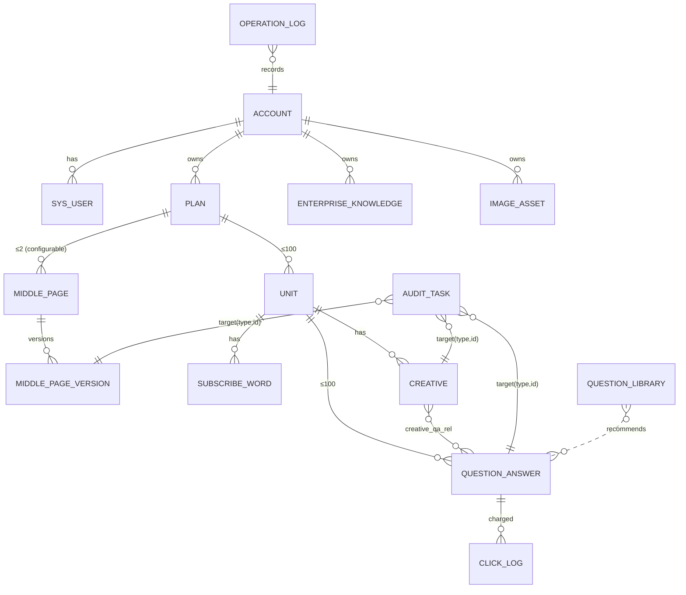
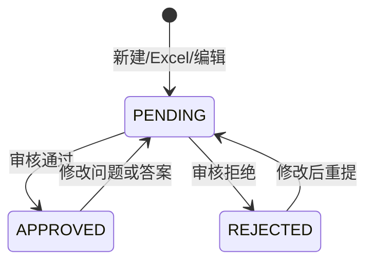
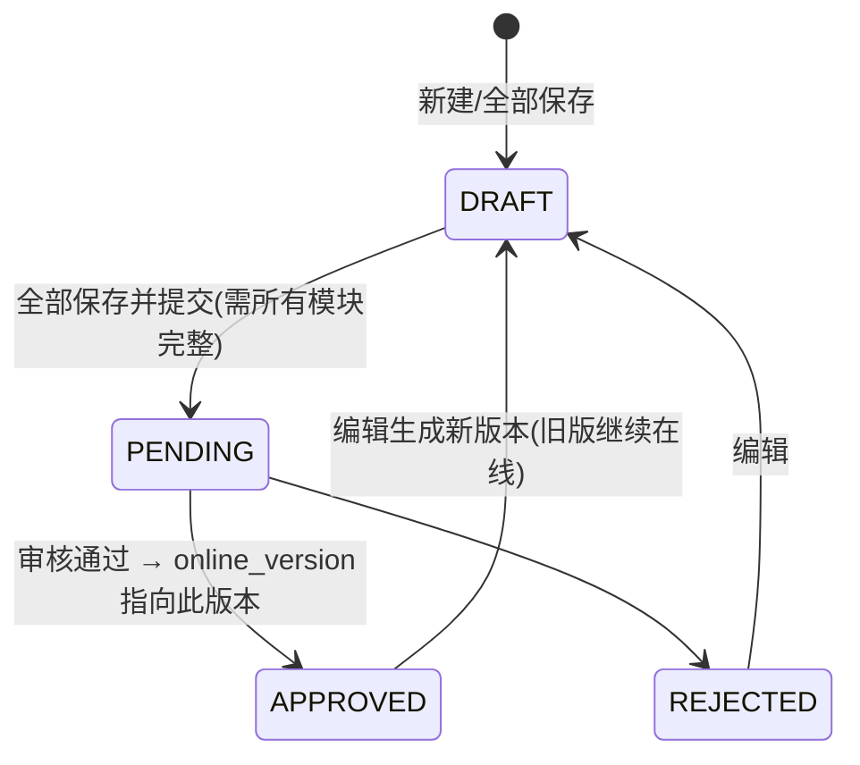

# Phoebe 重建 · 第二阶段：技术设计

> 除“Java + Spring Boot”[C] 外，本文所有技术选型都是**新建实现的选择**，不代表原项目技术栈。凡原项目可能不同之处，都通过接口/配置隔离，便于日后替换。
>
> **实现时的调整（以代码为准）**：
> - 未使用 Flyway，改用 Spring `spring.sql.init` 执行 `db/schema.sql`（`CREATE TABLE IF NOT EXISTS`）与 `db/data.sql`（`INSERT IGNORE`），MySQL / H2 通用且可重复执行。
> - Spring Boot 版本为 3.3.11（本机 Maven 仓库已有缓存）。
> - 操作日志由各 Service 显式调用 `OpLogService.log(...)`，未使用 AOP 注解。
> - 未引入 EasyExcel，Excel 解析用 Apache POI。
> - 创意表字段为 `image_urls`（JSON 数组），而非 `image_ids`。
> - 实际表结构、接口清单见 `06-数据库设计与ER图.md`、`07-API接口文档.md`。

## 1. 技术栈

| 层 | 选型 | 理由 | 与原项目关系 |
|---|---|---|---|
| 语言 | Java 17 | 本机已装 JDK 17；Spring Boot 3 最低要求 | 原版本 [U]（2016 年起的项目很可能是 Java 8） |
| 框架 | Spring Boot 3.3.x | | Spring Boot [C]，版本 [U] |
| 构建 | Maven 多模块 | 本机已装 Maven 3.9 | [U] |
| ORM | MyBatis-Plus 3.5 | 国内广告后台常见，SQL 可控，便于对照原 SQL | [U] |
| 数据库 | MySQL 8（默认）/ H2（测试、零依赖演示） | 本机已装 MySQL 8.3 | [U] |
| 迁移 | Flyway | 建表 SQL 版本化 | [U] |
| 权限 | Spring Security + JWT | 无状态，前后端分离 | [U]（原版大概率接入百度 UUAP/一站式 SSO [I]） |
| 文档 | springdoc-openapi (Swagger UI) | | — |
| Excel | Apache POI / EasyExcel | 问答批量上传 | [U] |
| 缓存/MQ | **不引入**，留接口 | 降低运行门槛；审核/计费以同步模拟实现 | Redis/MQ 使用情况 [U] |
| 前端 | Vue 3 + Vite + Element Plus + Pinia | | [U] |
| 测试 | JUnit 5 + Spring Boot Test + MockMvc（H2） | | — |

## 2. Maven 项目结构

```
phoebe-rebuild/
├── pom.xml                         # 父 POM，统一版本
├── phoebe-common/                  # 通用：Result、异常、枚举、证据等级注解、工具
├── phoebe-domain/                  # 实体 + Mapper + 领域服务（按业务包划分）
│   └── com.rebuild.phoebe.domain
│       ├── account/   plan/   unit/   qa/   creative/   middlepage/
│       ├── asset/ (图片、企业知识)   audit/   oplog/   stat/
│       └── rule/     # 可配置业务规则 PhoebeRules（数量上限、字数等）
├── phoebe-simulator/               # 模拟投放：问答知识库、触发词匹配、二价竞拍、点击计费
│   └── spi: QuestionLibraryProvider / AuctionEngine / BillingService
├── phoebe-web/                     # Spring Boot 启动模块：Controller、Security、配置、Flyway
│   └── src/main/resources/db/migration/V1__init.sql, V2__seed.sql
├── phoebe-ui/                      # Vue 3 前端（独立 npm 工程）
└── docs/
```

**替换点设计**：
- `PhoebeRules`（`application.yml` 前缀 `phoebe.rules.*`）集中所有数量/字数/中间页规则，标注来源。
- `AuditGateway`：默认 `SimulatedAuditGateway`（人工审核台 + 可选自动审核），可替换为真实业审系统对接。
- `AuctionEngine`、`BillingService`、`QuestionLibraryProvider` 均为接口，模拟实现在 `phoebe-simulator`。
- 自定义注解 `@Evidence(level = CONFIRMED|PUBLIC|INFERRED|UNKNOWN, source = "A")` 标注在关键规则代码上，可 grep 生成校准清单。

## 3. 数据库设计

### 3.1 ER 图



### 3.2 表清单（字段要点；完整 DDL 在第三阶段 `V1__init.sql`）

| 表 | 主要字段 | 说明 |
|---|---|---|
| `pb_account` | id, name, company_name, website, consult_url, industry, balance(DECIMAL 12,2), status | 广告主账户 |
| `pb_user` | id, account_id(null=内部), username, password_hash, role, status | 角色：ADVERTISER / AUDITOR / ADMIN |
| `pb_plan` | id, account_id, name, budget(null=不限), mobile_bid_ratio(DECIMAL 4,2), regions(VARCHAR 逗号码), mobile_phone, status(ACTIVE/PAUSED), budget_exhausted_date, deleted, created_at, updated_at | 唯一 (account_id, name, deleted) |
| `pb_middle_page` | id, plan_id, name, enabled, online_version_id, latest_version_id, deleted | 计划内 ≤N 套，启用 ≤1 |
| `pb_middle_page_version` | id, page_id, version_no, pc_style(IMAGE_TEXT/TEXT_LINK), pc_content JSON, mobile_content JSON, completeness(JSON 模块完成度), audit_status(DRAFT/PENDING/APPROVED/REJECTED), reject_reason, submitted_at | 版本化 |
| `pb_unit` | id, plan_id, name, bid(DECIMAL 8,2), status, deleted | |
| `pb_subscribe_word` | id, unit_id, word | |
| `pb_question_answer` | id, unit_id, question(VARCHAR 128), answer(MEDIUMTEXT 富文本), bid(null=用单元出价), source, audit_status, status, reject_reason, deleted | |
| `pb_creative` | id, unit_id, title, description, image_ids, audit_status, status, deleted | 高级创意 |
| `pb_creative_qa_rel` | creative_id, qa_id | 多对多，可调整 |
| `pb_enterprise_knowledge` | id, account_id, title, content | |
| `pb_image_asset` | id, account_id, url, width, height, source(UPLOAD/RECOMMEND), crop_size | |
| `pb_audit_task` | id, target_type(QA/MIDDLE_PAGE/CREATIVE), target_id, target_version, account_id, snapshot JSON, status, reason, auditor_id, created_at, audited_at | 审核快照 |
| `pb_question_library` | id, question, answer, keywords, pv, quality_flag, channel | 模拟“问答知识库” |
| `pb_impression_log` / `pb_click_log` | id, qa_id, unit_id, plan_id, account_id, channel(ZHIDAO/BAOBAO/SEARCH), device(PC/MOBILE), query, rank, bid_price, charge_price, created_at | 模拟日志 |
| `pb_daily_stat` | stat_date, level, target_id, device, impressions, clicks, cost | 报表聚合 |
| `pb_operation_log` | id, account_id, user_id, target_type, target_id, action, before_json, after_json, created_at | 历史操作记录 |

## 4. 状态流转

### 4.1 问答

投放状态 `status` 独立：ACTIVE / PAUSED。**可投放 = APPROVED ∧ ACTIVE ∧ 单元 ACTIVE ∧ 计划 ACTIVE ∧ 计划有启用的有效中间页 ∧ 预算/余额充足**。修改已通过问答后是否保留旧版在线 [U]，默认下线待审（可配置 `phoebe.rules.qa-keep-online-while-reaudit`）。

### 4.2 中间页（版本化，规则 [P]）

- 中间页对外状态：`有效`=有 online_version；`审核中`、`未通过`、`草稿`由 latest_version 决定。
- 启用：仅 `有效` 可启用；启用某套时自动停用同计划其他套。
- 导入：只能从 `有效` 中间页复制 online 版本内容覆盖当前草稿。

### 4.3 计划/单元
ACTIVE ⇄ PAUSED；计划另有派生状态 `BUDGET_EXHAUSTED`（当日消耗 ≥ 预算），次日自动恢复；账户余额 ≤ 0 时全部不可投放。

## 5. 权限与审核

| 角色 | 能力 |
|---|---|
| ADVERTISER（广告主） | 只操作本账户数据（所有查询带 account_id 过滤，Service 层校验归属） |
| AUDITOR（审核员，内部） | 查看审核队列、通过/拒绝（附原因），不能改物料 |
| ADMIN（运营） | 账户管理、充值（模拟）、规则查看、全量数据 |

- 审核以快照方式进行：提交时把当前内容写入 `pb_audit_task.snapshot`，审核结果回写目标版本，防止审核期间内容被篡改。
- 自动预审（[P] 规则）：长度、连续标点、违禁词表（配置化）；预审不通过直接拒绝。
- `phoebe.simulator.auto-approve=true` 时可一键自动审核，便于演示。

## 6. 日志
- `OperationLog` 通过 AOP 注解 `@OpLog(target=..., action=...)` 记录增删改，保存前后 JSON。
- 审核日志即 `pb_audit_task`。
- 投放日志 `pb_impression_log` / `pb_click_log`，并聚合到 `pb_daily_stat`。

## 7. REST API（前缀 `/api`，统一返回 `{code, message, data}`）

| 模块 | 方法 路径 | 说明 |
|---|---|---|
| 认证 | POST `/auth/login`、GET `/auth/me` | JWT |
| 账户 | GET `/account`、POST `/admin/accounts`、POST `/admin/accounts/{id}/recharge` | |
| 计划 | GET/POST `/plans`，GET/PUT/DELETE `/plans/{id}`，PUT `/plans/{id}/status` | 列表含统计 |
| 中间页 | GET/POST `/plans/{planId}/middle-pages`；GET `/middle-pages/{id}`；PUT `/middle-pages/{id}/draft`（全部保存/分模块保存）；POST `/middle-pages/{id}/submit`；POST `/middle-pages/{id}/enable`；POST `/middle-pages/{id}/import?fromId=`；POST `/middle-pages/{id}/copy-pc-to-mobile`；GET `/middle-pages/{id}/preview?device=PC|MOBILE&version=online|latest`；DELETE | |
| 单元 | GET/POST `/plans/{planId}/units`，GET/PUT/DELETE `/units/{id}`，PUT `/units/{id}/status`，PUT `/units/{id}/subscribe-words` | |
| 问答 | GET/POST `/units/{unitId}/qas`，PUT/DELETE `/qas/{id}`，PUT `/qas/{id}/status`，POST `/units/{unitId}/qas/upload`（Excel），GET `/qas/template` | |
| 推荐 | GET `/recommend/questions?keyword=` ；GET `/recommend/questions/by-unit/{unitId}`（订阅词）；GET `/recommend/quality-qas`；GET `/recommend/answers?question=` | 模拟问答知识库 |
| 创意 | GET/POST `/units/{unitId}/creatives`，PUT/DELETE `/creatives/{id}`，PUT `/creatives/{id}/qas` | |
| 资源 | CRUD `/knowledge`；GET/POST `/images`（上传/推荐） | |
| 审核 | GET `/audit/tasks?status=`；POST `/audit/tasks/{id}/approve`；POST `/audit/tasks/{id}/reject` | AUDITOR |
| 模拟投放 | POST `/simulator/search`（query, channel, device → 展现结果 + 竞价明细）；POST `/simulator/click`（impressionId → 计费）；POST `/simulator/traffic`（批量造流量） | |
| 报表 | GET `/reports?level=QA|UNIT|PLAN|MIDDLE_PAGE&from&to&device`；GET `/reports/export` | |
| 工具 | GET `/tools/bid-suggestion?qaId=`（出价助手）；POST `/tools/wizard`（智能引导一键建计划-单元-问答）；GET `/oplogs` | |
| 规则 | GET `/rules` | 当前生效规则及证据来源 |

## 8. 模拟竞价算法（新建实现 [I]）

1. `query` 经分词后与每条可投放问答的“触发词集”匹配：精确（问题标题 = query）或短语包含（query 包含问题核心词 / 订阅词）。触发词集 = 问题标题分词 + 单元订阅词。
2. 有效出价 `eBid = (qa.bid ?? unit.bid) × (device==MOBILE ? plan.mobileBidRatio : 1)`。
3. 排序分 `score = eBid × qualityScore`，`qualityScore` 由历史 CTR 平滑计算（点击调权 [P]）。
4. 每个广告位取第一名；计费 `charge = min(eBid, nextScore / ownQuality + 0.01)`（GSP，[I]）；无竞争者时按配置底价 `phoebe.simulator.min-price`。
5. 展现位置：知道检索页混排于自然结果第 4 位 [P]；问题页“相似问题”第 1 位 [P]。
6. 点击时：校验余额与计划当日预算 → 写 `click_log` → 扣余额 → 累加 `daily_stat`；中间页内点击只记录不计费 [P]。

## 9. 前端管理后台（Vue 3）

| 页面 | 内容 |
|---|---|
| 登录 | 账号密码 |
| 首页概览 | 余额、昨日/近7日展现点击消费、待处理（被拒物料、低质提示） |
| 推广管理 | 左侧计划-单元树；计划列表/详情（属性区 + tab：单元、中间页、数据）；单元详情（tab：问答、创意、订阅词） |
| 中间页编辑器 | PC/无线两步，分模块表单（企业信息/Banner/产品区），左表单右实时预览，导入、复制 PC→无线、全部保存、保存并提交 |
| 新建问答 | 三 tab：优质问答 / 推荐问题（关键词+订阅词）/ 手动创建；字数实时提示；Excel 上传与错误行回显 |
| 创意管理 | 高级创意表单 + 关联问答 + 预览 |
| 资源管理 | 企业知识、图片库 |
| 审核台（AUDITOR） | 队列、快照对比、通过/拒绝 |
| 投放模拟器 | 输入 query、选渠道/设备 → 模拟知道搜索结果页（含广告位标识与竞价明细），点击 → 计费 → 打开中间页预览 |
| 数据报告 | 层级/时间/设备筛选、图表 + 表格、导出 |
| 工具中心 | 操作记录、出价助手、智能引导、规则说明（含证据等级） |
