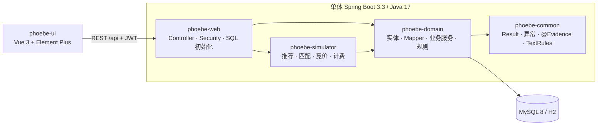

# 04 · 架构说明

> 本架构是新建实现，不代表原 Phoebe 的架构（原项目的模块划分、是否微服务、ORM、数据库都**完全未知**）。

## 1. 模块与依赖

| 模块 | 职责 | 关键类 |
|---|---|---|
| phoebe-common | 通用返回体、业务异常、证据等级注解、文本规则 | `Result`、`BizException`、`@Evidence`、`TextRules`、`UserContext` |
| phoebe-domain | 物料管理核心，可以单独看作 **“知识营销业务端”** | `PlanService`、`UnitService`、`QaService`、`CreativeService`、`MiddlePageService`、`AuditService`、`EligibilityService`、`ReportService`、`PhoebeRules` |
| phoebe-simulator | 代替百度检索、竞价、计费系统的**模拟器** | `CandidateLoader`、`MatchService`、`GspAuctionEngine`、`SearchSimulator`、`BillingService`、`BidAdvisor`、`WizardService` |
| phoebe-web | 对外 REST、JWT 认证、角色授权、SQL 初始化、演示数据 | `*Controller`、`SecurityConfig`、`JwtAuthFilter`、`StartupInitializer` |

**设计意图**：Phoebe 原项目更可能只是“物料管理业务端”，检索、竞价和计费由其他系统负责（推测，见差异清单 A2）。因此把模拟投放单独放在 `phoebe-simulator` 模块：如果证实原项目不含这部分，可以整体移除该模块，不影响 domain。

## 2. 替换点（日后对照原项目时校准）

| 替换点 | 当前实现 | 替换场景 |
|---|---|---|
| `PhoebeRules`（`phoebe.rules.*`） | 数量上限、字数、违禁词、行业、出价/预算范围 | 规则数值与原项目不一致时，直接改配置 |
| `AuditService` + `AuditTargetHandler` | 本地审核台 + 可选自动通过 | 接入真实业审系统：保留 Handler 回写，改为由外部回调触发 `approve/reject` |
| `QuestionLibraryProvider` | 读 `pb_question_library` 表 | 接入真实问答知识库（可能是其他内部系统） |
| `AuctionEngine` | GSP 实现 | 替换为真实竞价规则，或整体删除 |
| `JwtAuthFilter` / `UserContext` | 本地账号 + JWT | 接入百度一站式 / SSO 时，只需在过滤器里写入 `UserContext` |
| `PageContent`（JSON） | 中间页模块存在一个 JSON 列 | 原项目如果是多张模块表，替换 `MiddlePageVersion` 的持久化即可 |
| 表名前缀 `pb_` | 全部表 | 便于整体替换为原表名 |

用 `grep -rn "@Evidence" --include=*.java` 可以列出所有标注了证据等级的规则点。

## 3. 关键实现

### 3.1 权限
- 三类角色：`ADVERTISER`（只能操作本账户）、`AUDITOR`（审核台）、`ADMIN`（开户、充值、切换审核模式，可通过请求头 `X-Account-Id` 代登录广告账户）。
- URL 级别：`/api/audit/**` 仅限审核员和管理员，`/api/admin/**` 仅限管理员。
- 数据级别：`Guard` 在每次读写物料时校验 `account_id` 归属。为了做这个校验，单元、问答、创意、中间页表都冗余存了 `account_id` / `plan_id`。

### 3.2 审核（快照式）
1. 物料提交时，`AuditService.submit` 先作废同一对象的旧待审任务，再保存内容快照 JSON。
2. 机器预审：命中违禁词直接拒绝；链接主域与官网主域不一致时只给提示。
3. 人工审核（或自动通过模式）后，按 `targetType` 交给对应的 `AuditTargetHandler`，由它回写物料状态。
4. 问答和创意用 `auditVersion` 防止旧审核结果覆盖新内容；中间页审核对象是**版本 id**。

### 3.3 中间页版本
- `pb_middle_page` 有两个指针：`online_version_id`（最近一次审核通过的版本）和 `latest_version_id`（最新编辑的版本）。
- 编辑已通过的版本时，会复制出一个新的草稿版本，线上版本不动；新版本审核通过后，`online_version_id` 自动切换到新版本（公开资料 A）。

### 3.4 投放资格（`EligibilityService`）
可投放需要同时满足：问答审核通过且启用、单元启用、计划启用、计划有“启用 + 有线上版本”的中间页、账户启用且余额大于 0、今日消耗低于日预算、地域匹配。任何一项不满足，都会出现在计划列表的“投放诊断”和模拟器的“被排除原因”里。

### 3.5 模拟竞价与计费
- 匹配顺序：精确 → 短语包含（含去掉疑问词后的核心串）→ 订阅词 → 二元组相似度。
- 有效出价 = 问答出价（未设置则用单元出价）× 移动出价比例（仅移动端）。
- 质量度 = 平滑后的历史 CTR / 基准 CTR，限制在 [0.5, 2.0]，对应公开资料中的“点击调权”。
- GSP：得分 = 有效出价 × 质量度；计费价 = min(有效出价, 下一名得分 / 自身质量度 + 0.01)，且不低于底价；同一账户只取最优的一条问答参与。
- 计费：只有问答入口点击计费，同一次展现只计一次，余额最多扣到 0；中间页内的点击只记录、不计费。

## 4. 技术栈（新建选择）
Spring Boot 3.3.11 · Java 17 · Maven 多模块 · MyBatis-Plus 3.5.7 · MySQL 8 / H2（MySQL 模式）· Spring Security + JJWT · springdoc-openapi · Apache POI · Vue 3 + Vite + Element Plus + ECharts。
