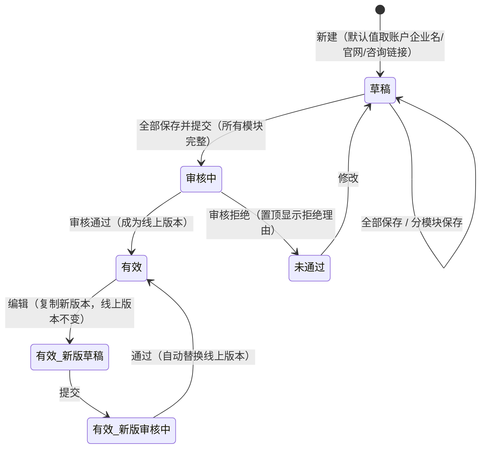
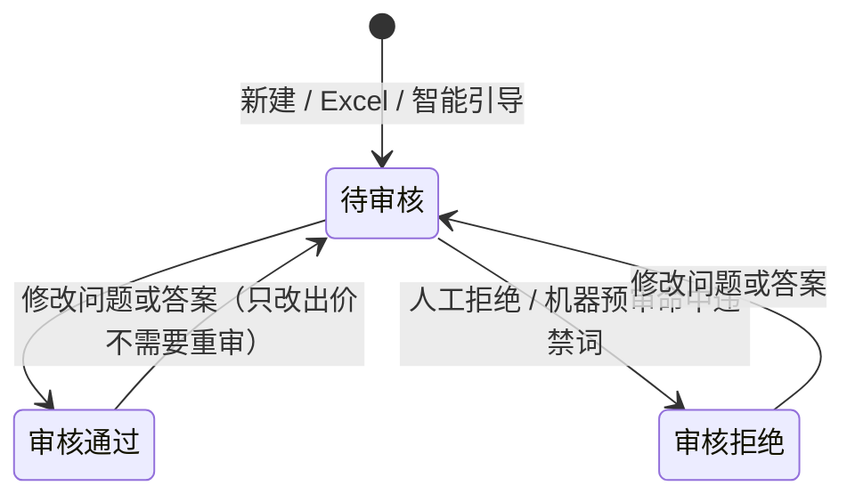

# 05 · 业务流程说明

证据等级：**[C]** 已确认 · **[P]** 公开资料支持 · **[I]** 合理推测 · **[U]** 完全未知

## 1. 开户与登录
1. 运营管理员在“账户管理”开户：填写企业名称、行业、官网、咨询链接、初始余额和登录账号。医疗服务、成人用品、彩票行业不能开户 [P:A,C]。
2. 广告主登录后只能看到本账户数据。管理员可以在页头“代登录账户”切换到某个账户操作 [I]。

## 2. 计划
- 字段：名称、日预算（可不限）、移动出价比例、推广地域、移动推广电话（选填）[P:A]。
- 每个账户最多 100 个计划 [P:B]。计划名称在账户内唯一 [I]。
- 状态：启用 / 暂停。删除为逻辑删除，并级联删除计划下的单元、问答、创意和中间页 [I]。
- 投放诊断：列表直接显示不可投放的原因（暂停、余额不足、今日预算用完、缺少有效中间页）。

## 3. 中间页

- 每个计划最多 2 套，同一时间只能启用 1 套；启用新的一套会自动停用另一套 [P:A,B]（可配置）。
- 必须审核通过（状态为“有效”）才能启用 [P:A]。启用中的中间页不能删除 [I]。
- 编辑分为 PC 和无线两部分；可以从 PC 一键生成无线页 [P:A,E]；PC 样式可选“图文”或“文字链” [P:E]。
- 导入：只能导入“有效”的中间页，导入会覆盖当前内容 [P:A]。
- 必填模块 [I]：企业信息（名称、Logo、官网、咨询链接或电话）、至少一张 Banner、至少一个产品（标题、链接；图文样式还需要图片）。
- 审核中不能编辑 [I]。

## 4. 单元
- 字段：名称、单元出价（作为问答默认出价）、订阅词 [P:A]。
- 每个计划最多 100 个单元 [P:B]；每个单元最多 50 个订阅词 [U]。
- 订阅词的作用：持续推荐相关的高 PV 问题；关键词推荐则是一次性的 [P:B]。

## 5. 问答

- 新建入口：优质问答（可直接采纳或编辑后采纳）、推荐问题（按关键词或订阅词推荐）、手动创建 [P:A]。
- 校验：问题 10–98 字符，答案 160–19998 字符（汉字按 2 个字符计）；不能有 ≥2 个连续标点；不能含违禁词 [P:A]。同一单元内问题不能重复 [I]。
- 编辑辅助：答案推荐、插入企业知识到答案末尾 [P:A]。
- 投放开关（启用 / 暂停）与审核状态相互独立 [I]。
- 每个单元最多 100 条问答 [P:B]。
- Excel 上传：第一列问题、第二列答案，首行如果是表头会跳过；单次最多处理 100 条，超出部分忽略；逐行校验并返回失败的行号和原因 [P:A,B]。

## 6. 高级创意
- 产品图片 + 产品描述 + 落地链接，可以关联同单元下的多条问答，需要审核 [P:A 存在；字段 I]。
- 当前没有让创意参与模拟展现，因为它与问答的关系、华表位的展现规则都未知 [U]。

## 7. 审核
- 提交即生成审核任务（保存快照），同一对象重复提交时旧任务作废。
- 机器预审：违禁词直接拒绝；主域不一致只提示 [P:B 存在“主域一致性”策略]。
- 审核员通过或拒绝（拒绝必须填写理由）。管理员可以开启“自动审核”便于演示。
- 真实产品承诺 3 个工作日内审核 [P:B]，系统不模拟这个时效。

## 8. 投放与计费（模拟）
1. 网民检索：选择渠道（百度知道 / 宝宝知道 / 网页搜索）、设备、页面类型、地域。
2. 召回能匹配上的问答，分成“可参与竞价”和“被排除（附原因）”两组。
3. GSP 竞价，同一账户只取最优的一条。
4. 混排：检索页放在自然结果第 4 位，问题页放在“相似问题”第 1 位 [P:B]。
5. 点击问答入口：按二价计费、扣余额、记录点击、累加日报，然后进入中间页（中间页展现 +1）。
6. 中间页内点击 Banner、产品、咨询、二维码：只记录，不计费 [P:B,C]。
7. 批量造流量：用问答知识库里的问题作为检索词，随机选择设备和渠道，按设定的点击率模拟点击。

## 9. 报表与工具
- 数据报告：账户 / 计划 / 单元 / 问答维度的展现、点击、点击率、消费、平均点击价格；中间页维度只有展现、点击、点击率；默认最近一周（截至昨日）；可按设备筛选；可下载 CSV [P:A,B]。
- 历史操作记录：默认最近一周，可按对象类型筛选 [P:A]。
- 出价助手：给出 PC 和移动端排到第一位所需的出价 [P:A 存在；算法 I]。
- 智能引导：输入关键词后，一键生成计划、单元、若干问答（来自优质问答）和中间页草稿 [P:A 存在；流程 I]。
- 资源管理：企业知识的增删改；图片管理支持本地上传和系统推荐，4 种裁剪比例 [P:A；比例 U]。
