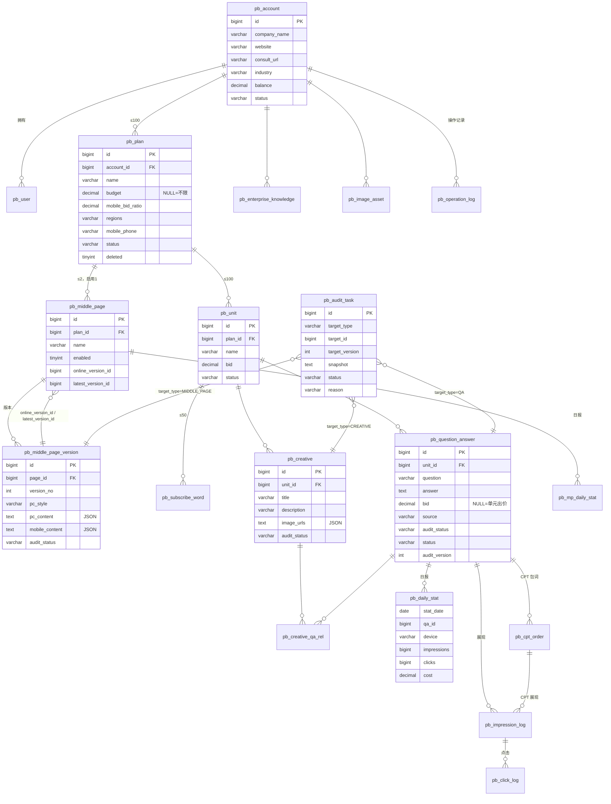

# 06 · 数据库设计与 ER 图

> 表名、字段名、枚举值均为**新建实现 [U]**，不是原 Phoebe 的数据库结构。建表脚本：[phoebe-web/src/main/resources/db/schema.sql](../phoebe-web/src/main/resources/db/schema.sql)；演示数据：[data.sql](../phoebe-web/src/main/resources/db/data.sql)。两份脚本都可以重复执行，MySQL 8 和 H2（MySQL 模式）通用。

## ER 图

## 表说明

| 表 | 用途 | 要点 |
|---|---|---|
| `pb_account` | 广告账户 | 企业名称、官网、咨询链接，作为中间页的默认值 [P:E] |
| `pb_user` | 登录用户 | 角色为 ADVERTISER / AUDITOR / ADMIN；内部用户的 account_id 为空 |
| `pb_plan` | 推广计划 | `budget` 为 NULL 表示不限；`regions` 是逗号分隔的省份，为空表示全部地域；`schedule` 为 168 位 0/1 投放时段（NULL=不限）；`excluded_ips` 为逗号分隔的排除 IP / IP 段 |
| `pb_unit` | 推广单元 | `bid` 是问答的默认出价 |
| `pb_subscribe_word` | 订阅词 | |
| `pb_question_answer` | 问答 | `audit_status` 与 `status`（投放开关）相互独立；`audit_version` 在每次内容变更时 +1 |
| `pb_creative` / `pb_creative_qa_rel` | 高级创意及其与问答的多对多关联 | 关联形式可调整 [U] |
| `pb_middle_page` / `pb_middle_page_version` | 中间页及其版本 | 两个版本指针，实现“修改期间旧版继续在线” [P:A] |
| `pb_enterprise_knowledge` | 企业知识 | |
| `pb_image_asset` | 图片库 | `crop_ratio` 取值 1:1 / 4:3 / 16:9 / 3:1（示例值） |
| `pb_audit_task` | 审核任务 | 快照式审核；`pre_check_result` 记录机器预审结论 |
| `pb_question_library` | 模拟问答知识库 | 虚构数据，`quality=1` 表示优质问答 |
| `pb_impression_log` / `pb_click_log` | 模拟展现 / 点击日志 | 展现时预先算好二价 `charge_price`；`click_type` 区分是否计费；展现日志的 `billing_type`（CPC/CPT）与 `cpt_order_id` 标识 CPT 展现 |
| `pb_daily_stat` | 问答 × 设备 × 渠道 × 地域 × 日 的日报 | 唯一键 `(stat_date, qa_id, device, channel, region)`；可以聚合到单元、计划、账户，支持报表“流量类型 / 分地域” |
| `pb_mp_daily_stat` | 中间页日报 | 不区分模块 [P:B]；同样按渠道、地域拆分 |
| `pb_budget_limit_log` | 预算达限记录 | 每计划每天最多一条（唯一键 `plan_id, limit_date`） |
| `pb_cpt_order` | CPT 包词订单 [C] | `keyword_norm` 为归一化后的词，用于独占冲突检查；`status` 只存 ACTIVE/CANCELED，待开始/投放中/已结束由日期推导；`total_price` 下单即扣款，`refund_amount` 为取消退款 |
| `pb_operation_log` | 历史操作记录 | 记录 `detail` JSON |

## 约定
- 主键使用自增 `BIGINT`。演示数据的主键是固定的，H2 下启动时会把各表的自增起点重置为 `max(id)+1`（`StartupInitializer`）。
- 物料表用 `deleted` 字段做逻辑删除，由 MyBatis-Plus `@TableLogic` 自动过滤。
- `created_at` / `updated_at` 由 `MetaObjectHandler` 自动填充。
- 从旧版本升级已有 MySQL 库：执行 `phoebe-web/src/main/resources/db/upgrade-2026-11-25.sql`（新库不需要；可重复执行；已在 MySQL 8.3.0 验证与全新安装结构一致）。
- MySQL 建库：`CREATE DATABASE phoebe DEFAULT CHARSET utf8mb4 COLLATE utf8mb4_general_ci;`
